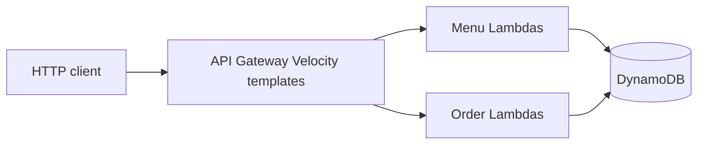

# Pizza shop (CMPE 273 Assignment 2)

A pizza ordering API built as a class project in spring 2017. Each REST endpoint is its own AWS Lambda function. API Gateway exposed the HTTP interface, and DynamoDB stored menus and orders. There is no web UI.

This repository is that project, brought up to Python 3 so the same handlers can run locally without an AWS account.

## Original context

| | |
| --- | --- |
| Course | CMPE 273, Enterprise Distributed Systems, San Jose State University |
| Term | Spring 2017 |
| Instructor | Sithu Aung |
| Author | Pranav Prem |
| Spec | [sithu/cmpe273-spring17, assignment 2](https://github.com/sithu/cmpe273-spring17/tree/master/assignment2) |
| Written | May 6–15, 2017 |

The assignment asked for menu CRUD and a short order conversation: the customer picks a selection, then a size, then sees a price. Customer accounts and sending the "we will email you" message were out of scope. The code records the order and returns that sentence.

The original runtime was Python 2.7. Functions were deployed with [python-lambda](https://github.com/nficano/python-lambda) 0.5.0 (`lambda deploy` / `lambda invoke`) to `us-west-2`, using boto3 1.4.1. Each folder's `config.yaml` is that tool's deploy config. The access-key fields are blank on purpose; the 2017 commit that added them says the credentials were kept out of the repo.

## How it works



API Gateway did not forward the raw HTTP body unchanged. Velocity templates rewrote path parameters into DynamoDB's low-level attribute format before Lambda ran, and rewrote some Lambda results on the way back out. Those templates are preserved in comments at the bottom of the handlers that needed them. `local_server.py` recreates the same translation so the handlers can be called over HTTP today.

Two tables, both with a string partition key:

| Table | Key | Written by |
| --- | --- | --- |
| `pizzashopmenu` | `menu_id` | menu Lambdas |
| `pizzashoporder` | `order_id` | order Lambdas |

Menu items use DynamoDB's typed JSON (`{"S": ...}`, `{"L": ...}`, `{"N": ...}`, `{"M": ...}`). Prices are numeric strings. Creating a menu also stores `sequence: ["selection", "size"]`, which is the order of the two questions the order API asks. The order item stores that detail under the attribute `ord` (not `order`).

An order moves through three statuses:

1. `POST /order`, while the store is open, writes the order as `selecting` and lists numbered selections.
2. `PUT /order/{id}` with `{"input": "1"}` saves that selection, moves to `ordering`, and lists sizes.
3. The next `PUT` saves the size and the matching price as `costs`, stamps `order_time` as `mm-dd-yyyy@hh:mm:ss`, moves to `processing`, and returns the price.

Store hours are strings like `10am-10pm`, interpreted in the process's local time at hour resolution. `10am-10pm` is open from 10:00 inclusive until 22:00 exclusive. A weekday missing from `store_hours` means closed all day. Ranges that cross midnight are not supported. Weekend hours in the assignment sample are `11am-12pm` (11:00 to 12:00), which is what the spec says.

## API

Ids are chosen by the client.

### `POST /menu`

```json
{
  "menu_id": "UUID-generated-by-client",
  "store_name": "Pizza Hut",
  "selection": ["Cheese", "Pepperoni"],
  "size": ["Slide", "Small", "Medium", "Large", "X-Large"],
  "price": ["3.50", "7.00", "10.00", "15.00", "20.00"],
  "store_hours": {
    "Mon": "10am-10pm",
    "Tue": "10am-10pm",
    "Wed": "10am-10pm",
    "Thu": "10am-10pm",
    "Fri": "10am-10pm",
    "Sat": "11am-12pm",
    "Sun": "11am-12pm"
  }
}
```

`200` with an empty body. "Slide" is the assignment's spelling.

### `GET /menu/{menu-id}`

```json
{
  "menu_id": "menu-1",
  "store_name": "Pizza Hut",
  "selection": ["Cheese", "Pepperoni"],
  "size": ["Slide", "Small", "Medium", "Large", "X-Large"],
  "sequence": ["selection", "size"],
  "price": ["3.50", "7.00", "10.00", "15.00", "20.00"],
  "store_hours": { "Mon": "10am-10pm" }
}
```

### `PUT /menu/{menu-id}`

Adds selection names that are not already on the menu. An empty body adds `Vegetable`, which is the case the assignment describes. Sending a selection list adds only the new names.

```json
{ "menu_id": "menu-1", "selection": ["Cheese", "Pepperoni", "Vegetable"] }
```

The handler's return value puts that object first: `(body, 200, "OK")`. The other handlers return the status first. `local_server.py` accepts both.

### `DELETE /menu/{menu-id}`

`200` with an empty body.

### `POST /order`

```json
{
  "menu_id": "menu-1",
  "order_id": "order-1",
  "customer_name": "John Smith",
  "customer_email": "foobar@gmail.com"
}
```

```json
{
  "Message": "Hi John Smith, please choose one of these selection: 1. Cheese, 2. Pepperoni, 3. Vegetable"
}
```

Outside store hours the status is still `200`, with `Restaurant is now closed` or `Restaurant closed today`, and nothing is written.

### `PUT /order/{order-id}`

```json
{ "input": "1" }
```

then

```json
{ "input": "4" }
```

```json
{ "Message": "Which size do you want? 1. Slide, 2. Small, 3. Medium, 4. Large, 5. X-Large" }
```

```json
{ "Message": "Your order costs $15.00. We will email you when the order is ready. Thank you!" }
```

`input` is 1-based. The assignment sample quotes it; a JSON number works too.

### `GET /order/{order-id}`

```json
{
  "menu_id": "menu-1",
  "order_id": "order-1",
  "customer_name": "John Smith",
  "customer_email": "foobar@gmail.com",
  "order_status": "processing",
  "order": {
    "selection": "Cheese",
    "size": "Large",
    "costs": "15.00",
    "order_time": "05-15-2017@10:30:00"
  }
}
```

The published spec labels this block as a request and omits two commas. It is the response.

## How to run it today

Requires Python 3.12. No AWS account is required for the local server or the tests.

```bash
python3.12 -m venv .venv
source .venv/bin/activate
pip install -r requirements-dev.txt
pytest
python local_server.py --now 2017-05-15T10:30:00
```

`--now` freezes the clock used for store hours and `order_time`. Without it, the server uses the machine's local time, so the sample menu rejects orders outside `10am-10pm` on weekdays and outside `11am-12pm` on weekends. That Monday in 2017 is inside weekday hours, which is why the sample session uses it.

The process listens on `http://127.0.0.1:8080`. `GET /` lists the routes. Stop it with Ctrl-C.

To use real DynamoDB instead of the in-memory tables, create `pizzashopmenu` (`menu_id`, string) and `pizzashoporder` (`order_id`, string) in the region you want, then:

```bash
export AWS_DEFAULT_REGION=us-west-2
export AWS_ACCESS_KEY_ID=...
export AWS_SECRET_ACCESS_KEY=...
python local_server.py --aws
```

Do not paste those keys into `config.yaml`. Leave the key fields blank.

`randomtesting.py` is the original scratch script for parsing `5pm`. It prints `17`.

## Sample session

There is no browser UI, so this is the interface. Captured from `python local_server.py --now 2017-05-15T10:30:00`.

```bash
curl -s -X POST localhost:8080/menu \
  -H 'Content-Type: application/json' \
  -d '{"menu_id":"menu-1","store_name":"Pizza Hut","selection":["Cheese","Pepperoni"],"size":["Slide","Small","Medium","Large","X-Large"],"price":["3.50","7.00","10.00","15.00","20.00"],"store_hours":{"Mon":"10am-10pm","Tue":"10am-10pm","Wed":"10am-10pm","Thu":"10am-10pm","Fri":"10am-10pm","Sat":"11am-12pm","Sun":"11am-12pm"}}'

curl -s -X PUT localhost:8080/menu/menu-1 -H 'Content-Type: application/json' -d '{}'

curl -s -X POST localhost:8080/order \
  -H 'Content-Type: application/json' \
  -d '{"menu_id":"menu-1","order_id":"order-1","customer_name":"John Smith","customer_email":"foobar@gmail.com"}'

curl -s -X PUT localhost:8080/order/order-1 -H 'Content-Type: application/json' -d '{"input":"1"}'

curl -s -X PUT localhost:8080/order/order-1 -H 'Content-Type: application/json' -d '{"input":"4"}'

curl -s localhost:8080/order/order-1
```

That session, run against this server, returns:

```json
{ "Message": "Hi John Smith, please choose one of these selection: 1. Cheese, 2. Pepperoni, 3. Vegetable" }
```

```json
{ "Message": "Which size do you want? 1. Slide, 2. Small, 3. Medium, 4. Large, 5. X-Large" }
```

```json
{ "Message": "Your order costs $15.00. We will email you when the order is ready. Thank you!" }
```

```json
{
  "menu_id": "menu-1",
  "order_id": "order-1",
  "customer_name": "John Smith",
  "customer_email": "foobar@gmail.com",
  "order_status": "processing",
  "order": {
    "selection": "Cheese",
    "size": "Large",
    "costs": "15.00",
    "order_time": "05-15-2017@10:30:00"
  }
}
```

The same menu at `2017-05-15T09:00:00` returns `Restaurant is now closed` and does not write an order.

## Tech stack

| Then (2017) | Now |
| --- | --- |
| Python 2.7 | Python 3.12 |
| boto3 1.4.1, botocore 1.4.61 | boto3 1.43.114 |
| python-lambda 0.5.0 | handlers are plain `service.handler` functions |
| API Gateway + Lambda + DynamoDB | same handlers; `local_server.py` plus [moto](https://github.com/getmoto/moto) 5.2.4 stand in locally |
| no tests | pytest 9.1.1 |
| no formatter | ruff 0.17.0 |

Lambda's current Python 3.12 runtime can run `service.py` with the handler set to `service.handler`. This repo does not add a deploy script or infrastructure-as-code; python-lambda 0.5.0 does not run on Python 3.12.

## Project structure

```
pizzashopmenupost/     POST /menu
pizzashopmenuget/      GET /menu/{menu-id}
pizzashopmenuput/      PUT /menu/{menu-id}
pizzashopmenudelete/   DELETE /menu/{menu-id}
pizzashoporderpost/    POST /order
pizzashoporderput/     PUT /order/{order-id}
pizzashoporderget/     GET /order/{order-id}
dynamoTest/            early "can Lambda reach DynamoDB?" experiment
hello-function/        python-lambda starter; not part of the API
local_server.py        local HTTP gateway and in-memory DynamoDB
randomtesting.py       scratch hour-parsing script
tests/                 handler tests and an HTTP walkthrough
```

Each function folder has `service.py` (the handler), `config.yaml` (old deploy metadata), and `event.json` (a sample event in the shape Lambda actually received, after the Velocity template).

## Tests and CI

```bash
pytest
ruff check .
ruff format --check .
```

GitHub Actions (`.github/workflows/ci.yml`) runs those three on Python 3.12 for pull requests and for pushes to `master`.

## Known limits

- Store hours ignore minutes and do not cross midnight. `12am` is hour 0, so a close time of midnight does not mean "end of day".
- `PUT /order` assumes `input` is in range. An out-of-range choice raises, and the local server returns 500.
- `GET` of a missing menu or order raises inside the handler. That matches the original functions.
- Nothing sends email.
- The handlers still speak DynamoDB's low-level item format. They are not a single web framework app, and the return tuples are still the ones API Gateway was wired to.
